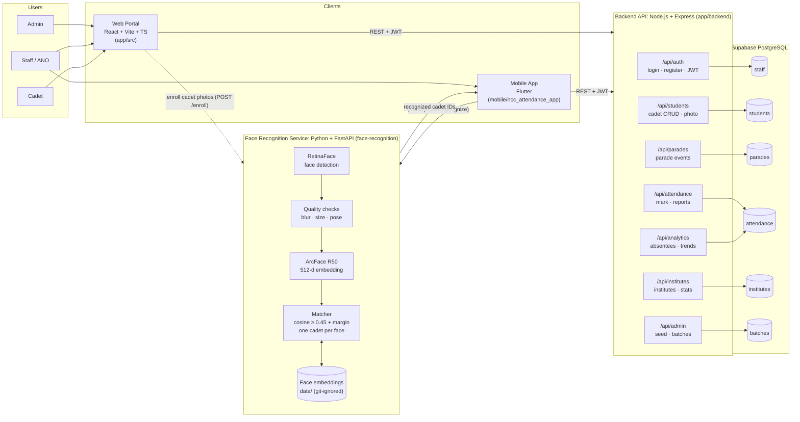
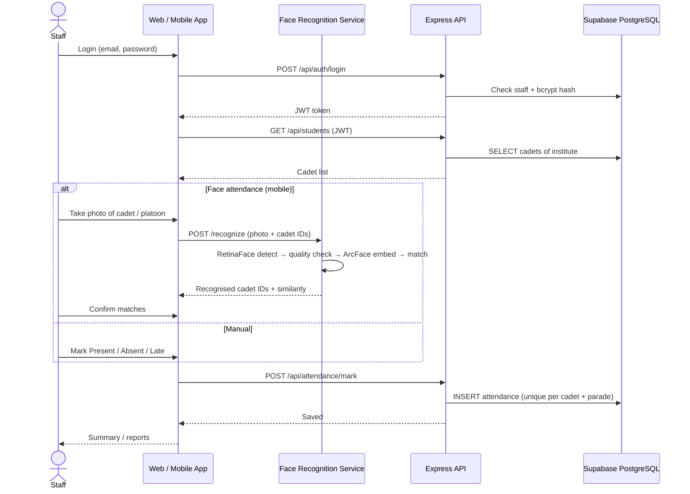
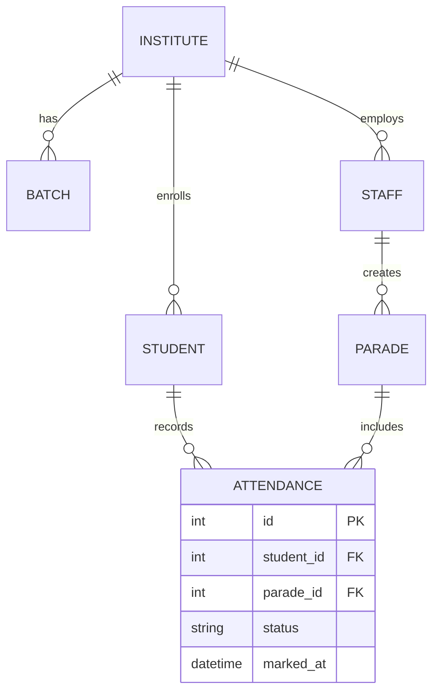

# NCC Attendance Portal (Attendance N Guard)

A system for recording NCC cadet attendance. It has student, staff and admin logins, cadet records with photos,
parade attendance, institute dashboards and monthly reports. A Flutter mobile app marks
attendance on the parade ground, and a **face recognition service** marks cadets present
from a single photo, even a group photo of a whole platoon.

| Layer | Tech |
|---|---|
| Web frontend | React + Vite + TypeScript + Tailwind / shadcn-ui |
| Mobile app | Flutter (Dart) |
| Backend API | Node.js + Express, JWT auth |
| Face recognition | Python + FastAPI, InsightFace **RetinaFace** detector + **ArcFace** embeddings |
| Database | Supabase (PostgreSQL) with Row-Level Security |

## System Architecture



### Attendance flow



### Data model



## Face recognition attendance

Staff take **one photo**, of a single cadet or a whole platoon. The service finds every face and
identifies each cadet. Staff confirm the matches and those cadets are marked Present.

| Step | What happens |
|---|---|
| Detection | **RetinaFace** finds every face, including small faces at the back of a group |
| Quality checks | Blurry, tiny, low-confidence or side-turned faces are **rejected, not guessed** |
| Recognition | **ArcFace (ResNet-50)** creates a 512-d embedding (about 99.8% on the LFW benchmark) |
| Matching | Cosine similarity ≥ 0.45 **and** a clear lead over the 2nd-best cadet. Each cadet matches one face at most |
| Enrollment | 3+ photos per cadet (front, slight left and right), compared by average and closest photo |
| Human check | Staff confirm the matches before anything is saved |

Details, API and settings: [face-recognition/README.md](face-recognition/README.md)

## How everything connects (APIs)

The full guide is **[docs/API_AND_INTEGRATION.md](docs/API_AND_INTEGRATION.md)**. It covers ports and config, the auth flow,
every endpoint with its request body and the file that calls it, how IDs link the systems, and an end-to-end sequence diagram.

| Service | Base URL | Main endpoints |
|---|---|---|
| Express API | `http://localhost:5001/api` | `/auth/login` · `/students` · `/attendance/mark` · `/attendance/report/:code` · `/parades` · `/institutes` · `/analytics/*` · `/admin/*` |
| Face recognition | `http://localhost:8000` | `/enroll` · `/recognize` · `/cadets` · `/health` |
| Database | Supabase `DATABASE_URL` | Tables: `institutes`, `batches`, `staff`, `students`, `parades`, `attendance` |

The key link: a cadet's **`students.id`** in Supabase is used as their **`cadet_id`** in the face service.
That way recognised faces map straight onto `attendance.studentId`.

## Folder layout

| Path | What it is |
|---|---|
| `app/` | **Main web project**: frontend in `app/src`, backend in `app/backend` |
| `app/backend/db_migrations/` | SQL migrations (RLS policies, password hashing) |
| `mobile/ncc_attendance_app/` | Flutter mobile app for marking attendance, manually or by face ([its README](mobile/ncc_attendance_app/README.md)) |
| `face-recognition/` | Python face detection + recognition service ([its README](face-recognition/README.md)) |
| `legacy/v1-attendance-n-guard/` | Earlier version (single-file Express + Supabase backend), kept for reference |
| `docs/API_AND_INTEGRATION.md` | **How all the components and APIs connect** |
| `docs/setup/` | Quick start, setup and login guide, Supabase setup, PostgreSQL migration notes |
| `docs/integration/` | Backend integration notes |
| `docs/testing/` | Testing checklist and sample API requests |
| `docs/team/` | Team contribution write-ups |
| `docs/credentials/` | Demo/seed login credentials for testing |
| `docs/design/` | Relational schema, admin use-case diagram, project summary poster |

## How to open and run

### Prerequisites
- [Node.js 18+](https://nodejs.org) and npm
- A [Supabase](https://supabase.com) project (free tier is fine)
- [Flutter SDK](https://docs.flutter.dev/get-started/install) (only for the mobile app)
- [Python 3.10+](https://www.python.org) (only for face recognition)

### 1. Clone
```bash
git clone <this-repo-url>
cd NCC
```

### 2. Backend (Express API, port 5001)
```bash
cd app/backend
cp .env.example .env      # then fill in DATABASE_URL and JWT_SECRET
npm install
node server.js
```
Run the SQL files in `app/backend/db_migrations/` in the Supabase SQL editor. See
[docs/setup/SUPABASE_SETUP.md](docs/setup/SUPABASE_SETUP.md) for details.

All data APIs need a login token (JWT). To create the first demo accounts, set `ALLOW_SEED=true`
in `.env`, restart the server and call `POST http://localhost:5001/api/admin/seed-full`.
Then set it back to `false`.

### 3. Web portal (React)
```bash
cd app
npm install
npm run dev
```
Open the URL Vite prints (usually http://localhost:5173 or http://localhost:8080).

### 4. Mobile app (Flutter)
```bash
cd mobile/ncc_attendance_app
flutter create .     # generates android/ios/web folders (one time)
flutter pub get
flutter run
```
The app works in demo mode without the backend. See the
[mobile README](mobile/ncc_attendance_app/README.md) for details.

### 5. Face recognition service (port 8000)
```bash
cd face-recognition
python -m venv .venv
.venv\Scripts\activate            # Linux/Mac: source .venv/bin/activate
pip install -r requirements.txt
uvicorn app.main:app --host 0.0.0.0 --port 8000
```
Enroll cadets: `python -m scripts.bulk_enroll path/to/photos` (one folder per cadet, named `<cadet_id>__<Name>`).
API docs: http://localhost:8000/docs

## Where each source repo went

| Source | Destination |
|---|---|
| [sushant8ds/attendance-n-guard](https://github.com/sushant8ds/attendance-n-guard) | Its commits are the base of `bhoomideshpande/ncc-attendence`, so its code is included in `app/` |
| [bhoomideshpande/ncc-attendence](https://github.com/bhoomideshpande/ncc-attendence) | `app/` (code) + `docs/` (guides) |
| [bhoomideshpande/attendance-n-guard](https://github.com/bhoomideshpande/attendance-n-guard) | `legacy/v1-attendance-n-guard/` |

## Team
| Member | Contribution |
|---|---|
| [Vinay Nissimagoudar](https://github.com/vinu2912) | Combined the project into one repo, Flutter mobile app, face recognition service, JWT security, architecture and API docs |
| [Sushant Tiwari](https://github.com/sushant8ds) | Initial NCC portal, photo upload, Attendance N Guard upload |
| [Bhoomi Deshpande](https://github.com/bhoomideshpande) | Supabase migration, backend integration, RLS policies and password security |
| Harsh Patil | UI styling and fixes |
| [Rakshitak21](https://github.com/Rakshitak21) | Early frontend work |
