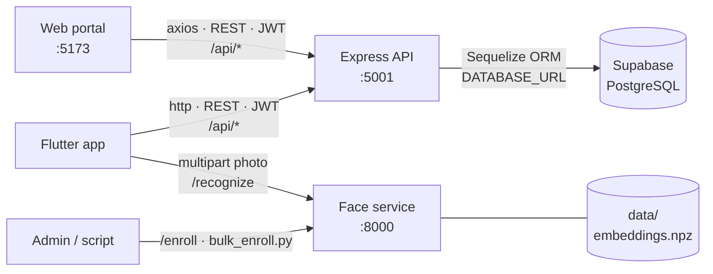
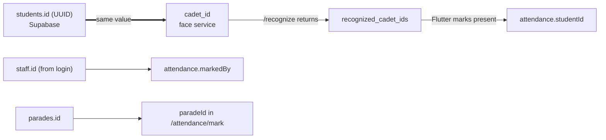
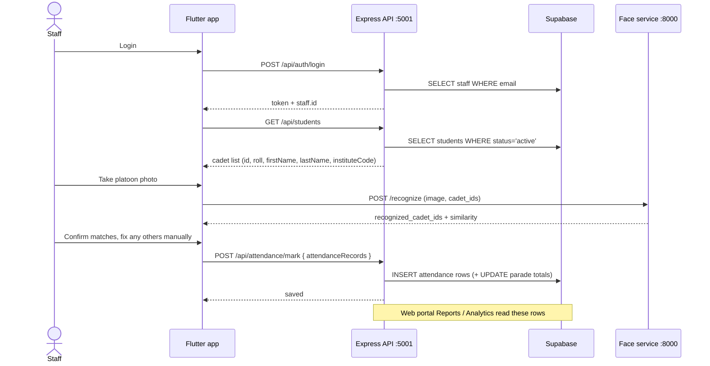

# How Everything Connects: API & Integration Guide

This guide explains how the parts of the NCC Attendance system talk to each other: which
component calls which API, on which port, with what data, and how the IDs link up.

## 1. Components and ports

| Component | Folder | Runs on | Talks to |
|---|---|---|---|
| Web portal (React + Vite) | `app/src` | `http://localhost:5173` (or 8080) | Express API |
| Mobile app (Flutter) | `mobile/ncc_attendance_app` | Phone / emulator / Chrome | Express API, Face service |
| Express API (Node.js) | `app/backend` | `http://localhost:5001/api` | Supabase PostgreSQL |
| Face recognition (FastAPI) | `face-recognition` | `http://localhost:8000` | Its own embedding store (`data/`) |
| Database | Supabase (cloud) | `DATABASE_URL` | – |

## 2. Configuration (where each URL is set)

| Setting | File | Default |
|---|---|---|
| Web → API base URL | `app/.env` → `VITE_API_BASE_URL` (read in `app/src/lib/api.ts`) | `http://localhost:5001/api` |
| API port | `app/backend/.env` → `PORT` | `5001` |
| Database | `app/backend/.env` → `DATABASE_URL` | – (Supabase connection string) |
| JWT signing key | `app/backend/.env` → `JWT_SECRET` | – (required; requests get `500` if it's missing) |
| Open the seed endpoints | `app/backend/.env` → `ALLOW_SEED` | `false` |
| Flutter → API | `mobile/.../lib/services/api_service.dart` → `baseUrl` | `http://10.0.2.2:5001/api` |
| Flutter → Face service | `mobile/.../lib/services/face_service.dart` → `baseUrl` | `http://10.0.2.2:8000` |
| Face thresholds | `face-recognition/app/config.py` (or env vars `FACE_*`) | match ≥ 0.45, margin 0.08 |

`10.0.2.2` is how the Android emulator reaches your PC. Use `localhost` for Chrome or the iOS simulator,
and your PC's LAN IP for a real phone.

## 3. Authentication flow

1. The client sends `POST /api/auth/login` with `{ email, password }`.
2. The backend checks the `staff` table and compares the password with its bcrypt hash.
3. It replies with `{ message, token, staff: { id, email, institute } }`. The token is a JWT valid for **1 hour**.
4. The client stores the token: the web app in `localStorage.token`, the Flutter app in memory.
5. Every later request sends the header `Authorization: Bearer <token>`. The web app logs out automatically on a `401`.

6. The backend checks the token with `verifyToken` (`app/backend/middleware/auth.js`). A missing, invalid or
   expired token gets **`401`**, and the logged-in staff member is available to route code as `req.user`.

| Route group | Protection |
|---|---|
| `/api/auth/login`, `/api/auth/register` | Public |
| `/api/students`, `/api/attendance`, `/api/parades`, `/api/institutes`, `/api/analytics` | **JWT required** |
| `/api/admin/*` | **JWT required**. Exception: `POST /admin/seed` and `/admin/seed-full` are open only while `ALLOW_SEED=true` (first-time setup) |
| Face service (`:8000`) | Not protected. Keep it on the internal network or behind a reverse proxy |

First-time setup: set `ALLOW_SEED=true` in `app/backend/.env`, call `POST /api/admin/seed-full`, then set it back to `false`.

## 4. Express API reference (`http://localhost:5001/api`)

The "Used by" column names the frontend file that calls each endpoint.
`web: student.ts` means `app/src/services/student.ts`.

### Auth: `/api/auth` (`backend/routes/auth.js`)
| Method | Path | Body / Query | Returns | Used by |
|---|---|---|---|---|
| POST | `/auth/login` | `{ email, password }` | `{ token, staff }` | web: `auth.ts` · Flutter: `api_service.dart` |
| POST | `/auth/register` | `{ id, email, password, institute }` | created staff | web: `auth.ts` |

### Students (cadets): `/api/students` (`routes/student.js`)
| Method | Path | Body / Query | Returns | Used by |
|---|---|---|---|---|
| POST | `/students/register` | student fields (`roll`, `firstName`, `lastName`, `instituteCode`, `photos`, …) | created student | web: `student.ts` |
| GET | `/students` | – | all active students | web: `student.ts` · Flutter |
| GET | `/students/institute/:instituteCode` | – | students of one institute | web: `student.ts` |
| GET | `/students/roll/:roll` | – | one student | web: `student.ts` |
| PUT | `/students/:id` | fields to update | updated student | web: `student.ts` |
| DELETE | `/students/:id` | – | message | web: `student.ts` |

### Attendance: `/api/attendance` (`routes/attendance.js`)
| Method | Path | Body / Query | Returns | Used by |
|---|---|---|---|---|
| POST | `/attendance/mark` | `{ paradeId, attendanceRecords: [{ studentId, roll, instituteCode, status, markedBy, paradeType }] }` | saved records | web: `attendance.ts` · Flutter |
| GET | `/attendance/student/:studentId` | – | a cadet's history | web: `attendance.ts` |
| GET | `/attendance/institute/:instituteCode/:date` | – | one day's attendance | web: `attendance.ts` |
| GET | `/attendance/report/:instituteCode` | `?startDate&endDate` | report data | web: `attendance.ts` |

`status` must be one of `present`, `absent` or `late`. If `paradeId` is given, that parade's
`totalPresent` and `totalAbsent` are updated as well.

### Parades: `/api/parades` (`routes/parade.js`)
| Method | Path | Body | Used by |
|---|---|---|---|
| POST | `/parades` | `{ instituteCode, date, type: regular\|special\|camp, conductedBy, notes }` | web: `parade.ts` |
| GET | `/parades` | – | web: `parade.ts` |
| GET | `/parades/institute/:instituteCode` | – | web: `parade.ts` |
| GET | `/parades/:id` | – | – |
| PUT | `/parades/:id` | fields to update | web: `parade.ts` |
| DELETE | `/parades/:id` | – | web: `parade.ts` |

### Institutes: `/api/institutes` (`routes/institute.js`)
| Method | Path | Body | Used by |
|---|---|---|---|
| GET | `/institutes` | – | web: `institute.ts` |
| GET | `/institutes/:id` | – | web: `institute.ts` |
| POST | `/institutes` | `{ code, name, shortName, battalion, logo, city }` | web: `institute.ts` |
| PUT | `/institutes/:id` | fields to update | web: `institute.ts` |
| GET | `/institutes/:id/stats` | – | web: `institute.ts` |

### Analytics: `/api/analytics` (`routes/analytics.js`)
| Method | Path | Query | Used by |
|---|---|---|---|
| GET | `/analytics/institute/:instituteCode` | `startDate, endDate, period` | web: `analytics.ts` |
| GET | `/analytics/student/:studentId/absences` | `limit` | web: `analytics.ts` |
| GET | `/analytics/institute/:instituteCode/batches` | – | web: `analytics.ts` |
| GET | `/analytics/stats/period` | `instituteCode, period` | web: `analytics.ts` |
| GET | `/analytics/students/absent/top` | `instituteCode, limit` | web: `analytics.ts` |

### Admin: `/api/admin` (`routes/admin.js`)
| Method | Path | Body | Purpose |
|---|---|---|---|
| POST | `/admin/seed-full` | – | Fill the database with demo institutes, staff and students |
| POST | `/admin/seed` | – | Smaller seed |
| POST | `/admin/:instituteId/batches` | `{ year, totalStudents }` | Create a batch |
| GET | `/admin/:instituteId/batches` | – | List batches |

## 5. Face recognition API reference (`http://localhost:8000`)

| Method | Path | Body | Returns | Used by |
|---|---|---|---|---|
| GET | `/health` | – | `{ status, model, enrolled_cadets }` | monitoring |
| POST | `/enroll` | multipart: `cadet_id`, `name`, `images[]` (3+) | accepted / rejected photos | admin, `scripts/bulk_enroll.py` |
| GET | `/cadets` | – | enrolled cadets | admin |
| DELETE | `/cadets/{cadet_id}` | – | – | admin |
| POST | `/recognize` | multipart: `image`, optional `cadet_ids` (comma-separated) | `{ faces_detected, recognized_cadet_ids, faces[] }` | Flutter: `face_service.dart` |

Interactive docs (Swagger) are at `http://localhost:8000/docs` while the service is running.

## 6. How IDs link the systems together

- **Enroll faces using the Student UUID as `cadet_id`.** That way the IDs the face service
  returns are the same IDs the Express API and database use.
- The Flutter app sends its cadet list as `cadet_ids` to `/recognize`, so faces are matched
  only against the cadets on that parade list.

## 7. End-to-end: marking attendance by face

## 8. Database tables (Sequelize models in `app/backend/models`)

| Table | Key fields | Links |
|---|---|---|
| `institutes` | `id`, `code`, `name`, `battalion`, `city`, `totalCadets` | `code` = `instituteCode` elsewhere |
| `batches` | `id`, `year`, `instituteId`, `totalStudents` | → institutes |
| `staff` | `id`, `staffId`, `email`, `password_hash`, `institute` | used as `markedBy` / `conductedBy` |
| `students` | `id`, `roll`, `firstName`, `lastName`, `instituteCode`, `photos`, `status` | `id` = face `cadet_id` |
| `parades` | `id`, `instituteCode`, `date`, `type`, `conductedBy`, `totalPresent`, `totalAbsent` | → staff |
| `attendance` | `id`, `studentId`, `roll`, `instituteCode`, `date`, `status`, `markedBy`, `paradeType` | → students, staff |

SQL security migrations (RLS policies, password hashing) are in `app/backend/db_migrations/`.
